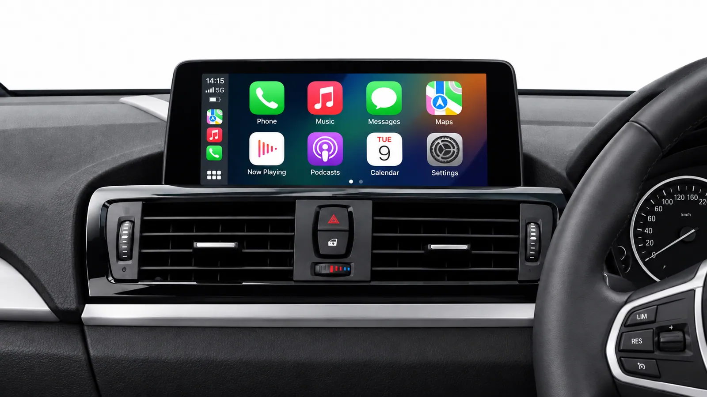
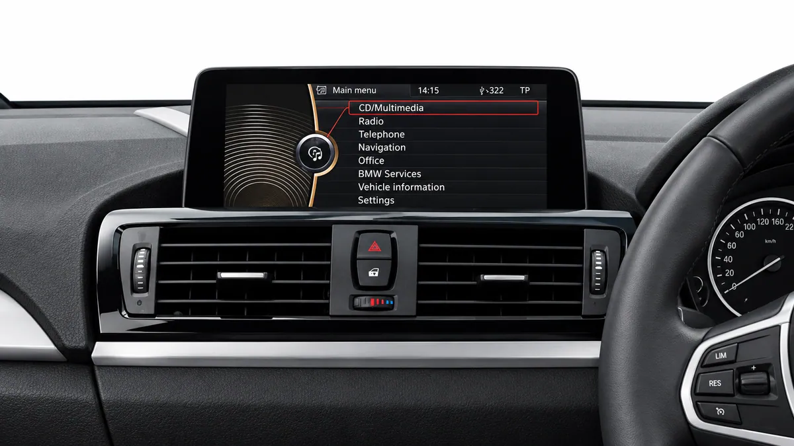
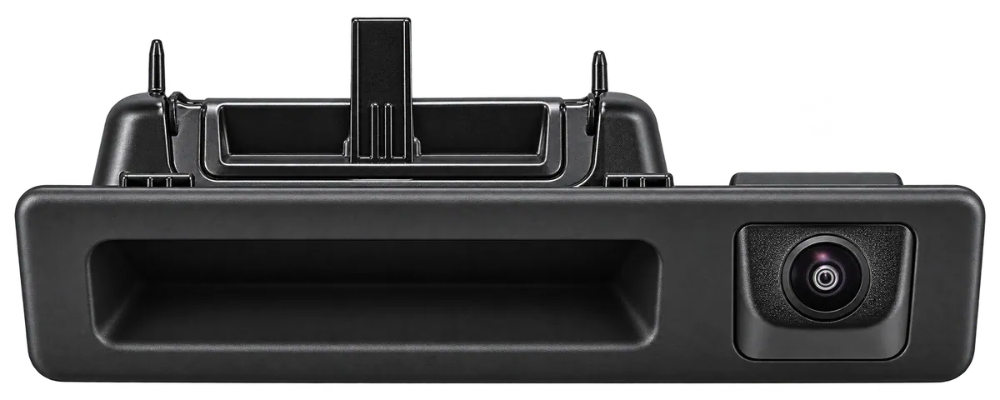

# SCW Group website — правила проекта

Сайт **scw-group.com** — статический HTML/CSS/JS без сборки, хостинг GitHub Pages
из ветки `main`. Всё, что попадает в `main`, сразу публикуется.

- Владелец просит изменения в чате и хочет, чтобы правки **сразу пушились в `main`**
  (без pull request). Каждая логическая правка — отдельный коммит с понятным описанием.
- Язык контента сайта — **английский**. Общение с владельцем — по-русски.
- Внешний вид менять только по просьбе владельца. Задача — единый стиль, а не редизайн.

## Дизайн-система

| Файл | Что внутри |
| --- | --- |
| `scw.css` | **Единственная** таблица стилей для новых страниц: токены (`:root`) и компоненты |
| `scw.js` | Шапка, футер, галерея, аналитика. Меню и контакты — в объекте `SITE` |
| `scw-analytics.js` | GA4 с согласием посетителя. Подключается из `scw.js`, вручную не добавлять |
| `_templates/` | Шаблоны всех типов страниц (Jekyll их не публикует) |

### Жёсткие правила
1. Новая страница = **копия шаблона** из `_templates/`, меняется только контент.
2. **Никаких** встроенных `<style>`, атрибутов `style="…"` и `!important` в страницах.
3. **Никаких** классов под конкретную модель (`.f30-…`, `.w222-…`, `.e90-profile`).
   Если компонента не хватает — добавить новый общий компонент в `scw.css`
   (с комментарием), и только потом использовать.
4. Цвета, размеры, радиусы — только через токены `:root` в `scw.css`.
5. Шапка и футер в странице — **пустые** `<header class="topbar"></header>` и
   `<footer class="site-footer"></footer>`, их заполняет `scw.js`.
   Активный пункт меню: `<body data-nav="news">`.
6. Картинки — только локальные пути `assets/…`. **Никогда** не ссылаться на
   `raw.githubusercontent.com` (старые страницы так делают — это исправляется при переносе).
7. Перед добавлением фото: макс. ширина **1600 px**, формат WebP или JPEG (качество ~80),
   вес до ~300 КБ, **удалить EXIF/GPS**. Имя файла по смыслу:
   `assets/bmw-f30-nbt-carplay-1.webp`, а не UUID.
   Сжатие: `node _tools/optimize-image.mjs <исходник> assets/<имя>.webp [ширина]`.
   Фото салона/экрана для карточек: 16:9, сверху белое «студийное» поле над торпедо
   (как у `assets/bmw-f30-cic-nbt.webp`); если экран упирается в верх кадра —
   добавить белое поле с плавным переходом (пример: `bmw-f30-entrynav*.webp`).
   Картинка для соцсетей (`og:image`) — JPEG 1200×630: `assets/{brand}-{chassis}-og.jpg`.
8. У каждого `` есть осмысленный `alt`; все картинки ниже первого экрана —
   `loading="lazy"`.

### Обязательная шапка `<head>` (уже есть в шаблонах)
`lang="en"`, `<title>Марка Модель (кузов) — Раздел — SCW</title>`, `description`
(до ~155 символов, упоминать Cyprus где уместно), `canonical`, Open Graph
(`og:title`, `og:description`, `og:image` = фото машины), `favicon.svg`,
`scw.css`, `<script src="scw.js" defer>`.
**Заголовок и alt должны соответствовать модели страницы** — при копировании
проверить, что не осталось названия другой модели.

## Типы страниц и имена файлов

Формат: `{brand}-{chassis}[-раздел].html`, всё строчными, через дефис.
`brand`: `bmw`, `mercedes`, `audi`, `lexus`, `toyota`, `suzuki`, `honda`…

| Тип | Шаблон | Файл (пример) |
| --- | --- | --- |
| Хаб модели (выбор услуги) | `_templates/model.html` | `bmw-f30.html` |
| Список мультимедиа-систем | `_templates/multimedia.html` | `bmw-f30-multimedia.html` |
| Решение: карточки + доп. оборудование | `_templates/solution.html` | `bmw-f30-nbt.html` |
| Решение: галерея + список опций | `_templates/solution-detail.html` | `bmw-f30-oem2.html` |
| Тюнинг (таблица мощности) | `_templates/tuning.html` | `bmw-g01-tuning.html` |
| Кодирование (список функций) | `_templates/coding.html` | `bmw-f45-coding.html` |

Навигация: `models.html?brand=…` (у модели в списке `d` указать `page:"bmw-f30.html"`) → хаб модели → раздел → решение.
Ссылка «назад» (`.back-link`) всегда ведёт на уровень выше, без пустых параметров.

## Компоненты `scw.css` (кратко)

- Раскладка: `.page` (основной контейнер), `.back-link`, `.divider` (красная черта),
  `.page-title`, `.page-intro`, `.section-title`, `.section-label` (красный заголовок группы)
- `.vehicle-hero` — марка / модель `<h1>3 Series <span>(F30)</span></h1>` / годы / текст / фото
- `.service-grid` + `.service-tile` (`.is-soon` — услуга пока недоступна)
- `.card-grid` (+`.is-narrow`) + `.card` → `.card-media` (по умолчанию фото 16:9 на всю
  площадь без белых полей; `.is-padded` — предмет на белом фоне; `.is-natural` — квадратные/высокие фото целиком) (под фото тонкая белая линия — `--card-media-line`) + `.card-body` (`.card-label`, `h3`, `p`, `.card-cta`).
  Кликабельная карточка — `<a class="card">`.
- `.detail` → `.gallery[data-gallery] > .gallery-track > img…` + `.detail-body.options`
- `.options` + `details.option > summary + .option-text` (`.options.is-plain` — длинные списки)
- `.choice-list` + `.choice` (`.has-dot`, `.is-soon`) — выбор модели, типа топлива и т.п.
- `.table-wrap > table.spec-table` (`td.is-accent` — красное значение) + `.table-note` + `.tag-list > span` (метки опций)
- `.card-media.is-pending > span` — фото пока нет («Photo coming soon»)
- Страница марки: `.filter-bar` + `.filter-chip` (`data-filter`, `data-only-ok`), `.model-list` > `.model-card[data-cat]` > `.model-thumb` + `.model-body` > `.gen-grid` > `a.gen` (`.is-ok` — есть решения), контейнер `main[data-catalog]`
- `.news-grid` + `.news-card` (`.news-date`, `h2`, `p`, ссылка)
- `.btn`, `.btn-ghost`

## Стандарт карточки (утверждён владельцем)

Карточка — главный блок сайта: фото сверху, текст снизу. Все карточки делаются
**только так**, без своих стилей.

**Как выглядит**
- Тёмная полупрозрачная плашка, тонкая светлая рамка, скругление 10 px
  (8 px на телефоне), мягкая тень.
- Сверху — **красная полоска**, тающая к середине.
- **Фото** — формат **16:9**, заполняет карточку от края до края (без белых полос по бокам
  и сверху/снизу), выровнено **по верху**: над экраном видно белое «студийное» поле.
- Между фото и текстом — **тонкая белая линия** (1 px, токен `--card-media-line`).
- **Текст** на тёмном градиенте: красная подпись (по желанию) → белый заголовок →
  серый текст 1–2 предложения → красная ссылка «Select →» (только у кликабельных).
- Сетка: 2 колонки на компьютере, 1 на телефоне. Список выбора — `card-grid is-narrow`.

**Три вида фото**
| Что на фото | Класс | Как подготовить |
| --- | --- | --- |
| Салон / экран (основной случай) | `card-media` | 16:9, белое поле над торпедо (см. правило 7) |
| Предмет на белом фоне (камера, блок) | `card-media is-padded` | целиком, с отступом, фон белый |
| Квадратное / высокое фото | `card-media is-natural` | показывается целиком, без обрезки |

**Тексты**
- Апгрейд мультимедиа: подпись `Multimedia upgrade`, заголовок
  `BMW Multimedia Upgrade — Option 1`, текст — что делаем, 1–2 предложения.
  Ограничения выделять `<strong>`: `<strong>Android Auto is not supported by this system.</strong>`
- Программное обновление: подпись `Software upgrade`.
- Доп. оборудование (камеры и т.п.): **без подписи**, фото `is-padded`, раздел
  `<h2 class="section-title">Additional Equipment</h2>`.
- Выбор системы (кликабельная): заголовок `BMW iDrive NBT`, текст `Original display`,
  `<span class="card-cta">Select →</span>`.
- `alt` фото: что на нём + модель: `BMW F30 original screen with Apple CarPlay`.

**Код**
```html
<!-- информационная карточка -->
<article class="card">
  <figure class="card-media"></figure>
  <div class="card-body"><span class="card-label">Multimedia upgrade</span><h3>BMW Multimedia Upgrade — Option 1</h3><p>Adding modern Apple CarPlay and Android Auto functionality to the existing screen without replacing it.</p></div>
</article>

<!-- кликабельная карточка выбора -->
<a class="card" href="bmw-f30-nbt.html">
  <figure class="card-media"></figure>
  <div class="card-body"><h3>BMW iDrive NBT</h3><p>Original display</p><span class="card-cta">Select →</span></div>
</a>

<!-- оборудование: предмет на белом -->
<article class="card">
  <figure class="card-media is-padded"></figure>
  <div class="card-body"><h3>Rear-view camera</h3><p>…</p></div>
</article>
```
Живой пример всех вариантов — страницы `bmw-f30-*.html`.

## Проверка перед пушем
- Открыть страницу на ширине **390 px** и **1366 px**: нет горизонтальной прокрутки,
  ничего не наезжает.
- Все ссылки и картинки открываются; «назад» ведёт куда нужно.
- Новую страницу добавить туда, откуда на неё переходят (хаб / список / `models.html`),
  и в `sitemap.xml`, когда он появится.

## Состояние переноса (обновлять по ходу)
Старые страницы ещё используют `styles.css`, `mercedes-*-styles.css`, `*-header.js`,
`vehicle-profile-shared.js` и общие `vehicle.html` / `solution.html`, где все модели
спрятаны в одном файле и переключаются скриптом. Их переводим на шаблоны **по одной
марке**, затем удаляем старые файлы. Старые адреса, на которые могут вести ссылки
из Google, оставлять как страницы-переадресации.

- [x] Дизайн-система `scw.css`, `scw.js`, шаблоны
- [x] Пилот: BMW F30 (`bmw-f30*.html`; старые `vehicle.html`/`solution.html` с параметрами F30 переадресуют сюда, в `models.html` у модели поле `page`)
- [x] Остальные BMW — все 14 моделей: хаб `bmw-{кузов}.html`, `-multimedia.html`, страницы систем, `-tuning.html`
  (бензин/дизель/гибрид на одной странице). Старые `vehicle.html`/`solution.html`/`tuning-fuel.html`
  с параметрами BMW, `oem1-3.html` для E90 и `tuning-e81/f20/f33/g01/g02.html`, `tuning.html` переадресуют сюда.
  Кодирование BMW пока на общем `coding.html?brand=…&model=…`.
- [x] Mercedes-Benz — перенесены 9 моделей с реальным контентом (W176, W246, CLA C117, GLA X156, W204,
  W205, W212, W222, SLK R172): `mercedes-{кузов}.html`, `-multimedia.html`, `-{система}.html`.
  Тюнинг Mercedes — «coming soon» (данных нет; раньше по ошибке открывалась таблица BMW F45).
  Остальные 20 моделей (W177, W247, EQ… ) — страницы-заглушки `mercedes-{кузов}.html` (решение владельца):
  все услуги «coming soon» + кнопка Get a quote. Когда появится контент — заменить заглушку на хаб.
- [x] Страница выбора моделей Mercedes — `mercedes-models.html` (модель → кнопки поколений, фото, красная
  метка «есть решения», кнопка «только с решениями» и метка «Solutions available»; фильтры по типу кузова и блок с VIN владелец попросил убрать). Компоненты `.filter-bar`, `.model-list`,
  `.model-card`, `.gen` (`.is-ok`) в scw.css, фильтры — `[data-catalog]` в scw.js.
  `models.html?brand=Mercedes-Benz` переадресует сюда. Так же сделана `bmw-models.html` (поколения без страницы —
  `<span class="gen">`, не кликабельные; со страницей-заглушкой — `<a class="gen">` без `.is-ok`). Для других марок — по просьбе владельца.
- BMW 1 Series F40, F70 — страницы модели без контента (`bmw-f40.html`, `bmw-f70.html`, генератор как у заглушек Mercedes):
  фото, годы, все услуги «coming soon», Get a quote. Мультимедиа/системы — когда владелец даст контент.
- [ ] Audi, Lexus, Toyota, Suzuki, SLK
- [ ] Главная, новости, каталог моделей, тюнинг
- [ ] Удалить `styles.css` и старые скрипты
- [ ] Сжать фото, убрать неиспользуемые, `sitemap.xml`, `robots.txt`, `404.html`
